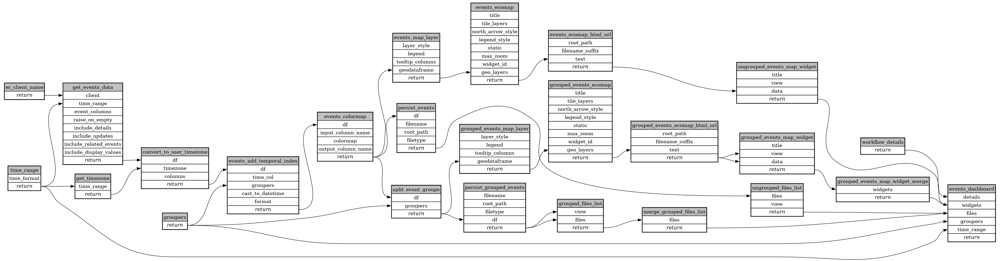

```
# AUTOGENERATED BY ECOSCOPE-WORKFLOWS; see fingerprint in README.md for details

```

```yaml
# fingerprint:
artifacts_sha256_basic: 89d2f3d9047663695eec81cbb3c1e7ec7f8b279d07da659bd4ea58f829689c7e
artifacts_sha256_strict: 26e1fac3d6ff0625813c8014b07a2b27dcc120d16a9f587feb73c92d8f968a83
installed_requirements:
- channel: https://repo.prefix.dev/ecoscope-workflows/
  name: ecoscope-platform
  version: {version: ==2.31.0}
- channel: conda-forge
  name: pydeck
  version: {version: ==0.9.2}
params_sha256: 8daf68602b5cbdb7871dcd41a29ff0d7598244f70d2d9f95755e178404e94c8c
spec_sha256: 68313e3f18d3b5670f09df8fc0a29d6e59ef22ace4e2c989123049400916e4e5

```

# ecoscope-workflows-test-dashboard-workflow



